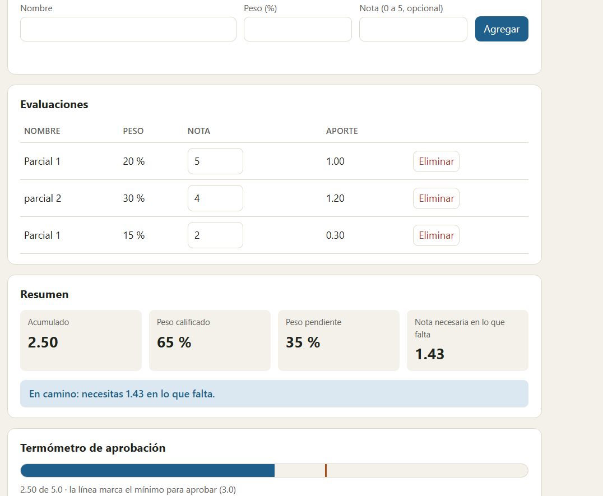

# Entrega · Laboratorio MVC · Notas del semestre

**Equipo:** ______________________  
**Integrantes:** Juan Esteban Escobar
**Repositorio:** ______________________

> Completa este archivo a medida que avanzas (cada sección dice en qué parte de la guía se llena).
> Escribe con tus palabras: las respuestas copiadas de la guía o de otro equipo no cuentan.

---

## 1. Mapa de responsabilidades (Parte 1)

Clasifica cada fragmento de `espagueti.html`: **M** (Modelo), **V** (Vista), **C** (Controlador) o **Mezcla**
(en ese caso, escribe qué roles se mezclan). En "¿Por qué?" justifica en una frase.

| # | Fragmento | Rol(es) | ¿Por qué? |
|---|---|---|---|
| 1 | `var n = document.getElementById('nombre').value.trim();` | V |Lee lo que el usuario escribió en la pantalla. En MVC es leerFormulario() de la Vista |
| 2 | `if (isNaN(p) \|\| p < 1 \|\| p > 100) { err.textContent = 'El peso debe estar entre 1 y 100.'; return; }` | M+V|La regla del peso (R3) está pegada a escribir el mensaje en el DOM |
| 3 | `if (total + p > 100) { err.textContent = '...'; return; }` | M+V| La regla de la suma de pesos (R5) se decide y se muestra en la misma línea|
| 4 | `evals.push({ id: sig++, nombre: n, peso: p, nota: nota });` |M | Crea el dato y asigna su id: es estado del negocio|
| 5 | `localStorage.setItem('notas.v1', JSON.stringify(evals));` | M| Es persistencia, no tiene que ver con la pantalla. En MVC queda detrás del contrato cargar() y guardar()|
| 6 | `document.getElementById('nombre').value = '';` | V| Solo cambia la pantalla. En MVC es limpiarFormulario(), y el Controlador decide cuándo llamarlo|
| 7 | `'<input ... onchange="ponerNota(' + e.id + ', this.value)">'` |C+V |Arma HTML con texto (V) y deja atado el evento dentro del HTML (C) |
| 8 | `nec = Math.ceil(nec * 100 - 1e-9) / 100;` |M | Es cálculo del negocio (nota necesaria redondeada hacia arriba)|
| 9 | `if (acum + 1e-9 >= 3.0) { txt = '¡Aprobado! ...'; cls = 'ok'; }` |M+V |La regla de aprobar y el texto y la clase CSS están juntos |
| 10 | `document.getElementById('tabla').innerHTML = filas;` |V |Dibuja la tabla |
| 11 | `function borrar(id) { ...splice...; localStorage.setItem(...); pintar(); }` |M+V | Reacciona al clic, cambia los datos, guarda y redibuja, todo en una función|
| 12 | `(e.peso * e.nota / 100).toFixed(2)` | V| Es un valor derivado que se formatea para mostrar. En la guía, el aporte lo calcula la Vista|

## 2. Olores del espagueti (Parte 1)

Lista **al menos 5** problemas de diseño de `espagueti.html`. Para cada uno, escribe qué consecuencia tiene
cuando el proyecto crece y en qué pieza de MVC viviría la solución.

| Olor | Consecuencia | Dónde se arregla (M, V o C) |
|---|---|---|
| Es un valor derivado que se formatea para mostrar. En la guía, el aporte lo calcula la Vista| Cualquier función puede cambiar los datos sin control, y es difícil seguir quién los modificó | M (estado privado en NotasModelo)|
| Una misma regla escrita en más de un lugar (por ejemplo, la validación de la nota)| Si cambia la regla, hay que acordarse de editar todos los sitios y es fácil olvidar uno| M (un solo método de validación)|
| Valores «mágicos» repetidos (3.0, 1e-9)| Cambiar la nota mínima obliga a buscar y editar varios lugares| M (constantes NOTA_MINIMA y EPS)|
| HTML armado con texto e innerHTML| Un nombre como <b>hola</b> se interpreta como HTML y abre la puerta a inyección de código| V (createElement y textContent)|
| Funciones que hacen varias cosas a la vez (como borrar)| Cuesta leerlas, probarlas y reutilizarlas| Repartir entre C (reacciona), M (cambia datos) y V (dibuja)|

## 3. El flujo de «agregar una evaluación» (Parte 6)

Dibuja (a mano y pega una foto, o con texto/Mermaid) el recorrido completo desde que el usuario presiona
**Agregar** hasta que ve la fila nueva en la tabla. Marca en cada paso **el archivo y el método** que actúa.

```text
(tu diagrama aquí)
```

## 4. Evidencias (Partes 2, 3, 4 y 6)

**Salida de `npm test`** (pega el final, donde dice cuántas pruebas pasan):

```✓ 54 de 54 pruebas pasan.

```

**Salida de `npm run arquitectura`:**

```15 de 15 pruebas pasan.

```

**Captura de pantalla** de la app con las dos vistas (la tabla/resumen y el termómetro): !

## 5. Tres cambios, tres lugares (Parte 5)

Después de cada cambio ejecuta `git diff --stat HEAD~1` (o `git show --stat`) y pega el resultado.
La idea: **cada cambio debía tocar solo las piezas que le corresponden**.

| Cambio | Archivos que tocaste | ¿Era lo esperado? ¿Por qué? |
|---|---|---|
| 5A · Nombres únicos |src/modelo.js  5 ++++- | |
| 5B · Segunda vista (termómetro) | | |
| 5C · Otro almacén | | |

## 6. Reflexión (Parte 6)

1. En la versión espagueti, ¿qué tuviste que leer o tocar para entender dónde se decide si el estudiante aprobó? ¿Y en la versión MVC?
2. ¿Por qué el Modelo **no** debe llamar a `alert()` ni a `document`? ¿Qué pasaría con las pruebas del Modelo si lo hiciera?
3. El Modelo avisa de sus cambios sin saber quién escucha (Observer). ¿Qué ganamos con eso frente a que el Modelo llame directamente a `vista.render()`?
4. Elige un olor de MVC (controlador gordo, lógica en la Vista, Modelo que toca la pantalla, Modelo anémico) que te hubiera sido fácil cometer hoy. ¿Cuál y cómo lo evitaron?
5. ¿Para qué tipo de aplicación **no** usarías MVC? Justifica con lo que viste en el laboratorio.
